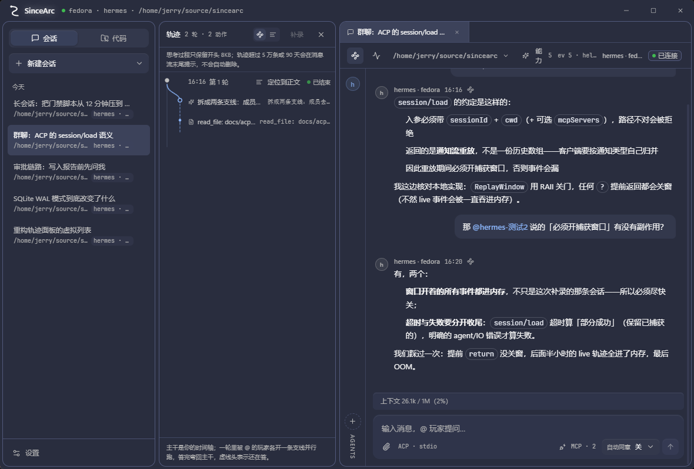

<p align="center">
  
</p>

<h1 align="center">SinceArc</h1>

<p align="center">
  One window for every agent you run: several CLI agents, their sessions and their sub-agents in a single
  place — and the thinking behind each answer kept out of the way, where you can still look it up.
</p>

<p align="center">
  <a href="LICENSE"></a>
  
  
  <a href="https://github.com/wangsyiiz/SinceArc/actions/workflows/release.yml"></a>
</p>

<p align="center">
  <strong>English</strong> · <a href="README.zh-CN.md">简体中文</a>
</p>

<p align="center">
  
</p>

---

## What this is

SinceArc is a Windows desktop client for agents speaking [ACP (Agent Client Protocol)](https://agentclientprotocol.com).
Tauri 2, React 19, TypeScript and Rust; everything is stored in a local SQLite database and never uploaded.

The thing it is built around is **aggregation**. Running one agent in a terminal is fine. Running four — a
planner, a coder, a reviewer, plus the one you started yesterday and forgot the working directory of — is not:
context gets copied between windows, you lose track of which agent is on which task, and nothing tells you what
they actually did. SinceArc puts them on one timeline with one set of sessions, one set of profiles and one
place to answer "what is everyone doing right now". Group chat is how it delivers that as a lighter
experience: agents join a session as members, so working with four of them feels like one conversation
instead of four window switches.

## Why another client

**1. Many agents, one place to manage them** *(the main reason)*

- A **profile** describes one agent launch: this machine, a WSL distro, or a host over SSH — with its own cwd,
  env and MCP servers. Switch agent per session instead of per terminal window.
- **Group chat**: add agents as members of a session, then `@` one. It runs on its own branch in parallel,
  merges back into the trunk when it answers, and its messages stay attributable to it.
- **One trace per session** collects what *all* members did — filters by player, so you can read just the
  reviewer's tool calls, or the whole picture.
- **Approvals, MCP servers and storage** are managed in the same window, not in five shell configs.

**2. A GitHub desktop client** — *planned.* PRs, issues and reviews in the same window, with agents taking part
in them over ACP. Listed here because it is the next thing this architecture is good for, not because it exists.
See [Roadmap](#roadmap).

**3. Process kept apart from prose.** Replies stay in the chat; thinking, tool calls and permission prompts go
into a trace panel, and the two cross-link by anchor. When something goes wrong you can look back at *why* the
agent did it instead of scrolling through one endless message stream.

## Capabilities

| What it does | Notes |
| --- | --- |
| Aggregate agents | Multiple profiles; a session picks its agent; local / WSL / SSH launch kinds |
| Group chat with sub-agents | `@` a member to run it on its own branch in parallel, merging back to the trunk |
| One trace for everyone | Per-player lanes and filtering; virtualized list; graph view degrades above 1500 activities |
| Approvals | Per-kind permission requests, plus "allow same kind for this turn" (in-memory, expires at turn end) |
| Streaming replies | Tweened output, seal-first (aligns to full text the moment a turn ends); can be turned off |
| Markdown | Fenced code, inline code, lists, tables, links — parsed into elements, never injected as HTML |
| Syntax highlighting | Prism, five themes, inline code uses the same theme; SinceArc palette by default |
| External links | Scheme allowlist, validated on both sides of the IPC boundary |
| Storage notice | Counts and warns only; nothing is ever deleted automatically |

**What it does not do** (so you don't find out after installing):

- **Windows x64 only** — no macOS, no Linux, no ARM64, and no unverified artifacts;
- **No code signing** — SmartScreen warns about an unknown publisher on first run;
- **No auto-update** — upgrades are a manual download;
- **No GitHub integration yet** — that is roadmap, not shipped;
- **No single-instance mode / `sincearc .` reverse entry**;
- The trace panel loads 50 turns at a time (server cap: 200), so **you cannot page back to older traces yet**.

## Install

> The first release `v0.0.0` is not tagged yet; the path below describes what it will look like.

1. From [Releases](https://github.com/wangsyiiz/SinceArc/releases) grab `SinceArc-<version>-win-x64.zip` (portable)
   or `SinceArc_<version>_x64-setup.exe` (installer);
2. Portable: extract anywhere (do not double-click inside the zip), then run `SinceArc.exe`;
3. If SmartScreen warns, choose "More info → Run anyway" (unsigned);
4. WebView2 Runtime is required: Windows 11 and recent Windows 10 ship it. If missing, install the
   [Evergreen Runtime](https://developer.microsoft.com/microsoft-edge/webview2/).

Data lives in `%APPDATA%\com.sincearc.app` (`sincearc.db` and `logs\`). Deleting the program folder does **not**
delete your data; delete that directory to wipe everything. Full details in
[`docs/distribution.md`](docs/distribution.md) (Chinese).

## Build from source

Requires Windows, Node 20+, Rust stable (`rust-version = 1.77.2` or newer) and WebView2 Runtime.

```powershell
npm ci
npm run tauri -- build --no-bundle     # -> src-tauri/target/release/sincearc.exe
npm run package:win                    # -> artifacts/windows/SinceArc-<version>-win-x64.zip
```

For development:

```powershell
npm run tauri dev    # vite frontend + Rust shell (debug build loads http://localhost:5173)
npm run dev          # frontend only
```

> Run `npm install` / `npm ci` with **Windows Node**. Installing from WSL writes the Linux build of the rolldown
> native binding into the lockfile, and `vite build` then fails with `Cannot find native binding`.

Releases are built in CI: push a `v*` tag or run the `release` workflow manually; the Windows runner produces
both the portable zip and an NSIS installer. (You cannot build the installer locally — on first bundling Tauri
downloads NSIS from GitHub; see [`docs/distribution.md`](docs/distribution.md) §6.)

## Architecture

```
src/                      Frontend: React 19 + TS + Tailwind 4 (Vite; the bundle is embedded into the exe)
  lib/ipc/                Command wrappers (no command strings inside components)
  lib/virtual/            Virtual list (the only place allowed to import @tanstack/react-virtual)
  lib/highlight/          Prism adapter + theme table
  lib/markdown.ts         marked.lexer -> our own block/inline model (never emits HTML strings)
src-tauri/src/
  acp/                    ACP connection, process management (Local / WSL / SSH launch), event capture
  db/                     SQLite (atoms as the single authority + turns/sessions/members; numbered migrations)
  commands.rs             IPC command layer (business logic lives in Rust; the frontend only renders)
docs/                     Specifications (Chinese) — written before the code
```

Rules to know before touching code (details in [`docs/dev-rules.md`](docs/dev-rules.md), [`docs/architecture.md`](docs/architecture.md)):

- ACP types exist only under `src-tauri/src/acp/`; the frontend consumes DTOs;
- Streaming tokens go into zustand, not the React Query cache;
- Message rendering **never touches `dangerouslySetInnerHTML`**; links allow `http` / `https` / `mailto` only;
- The trace captures notification events only (thought / tool_call / mode / usage) — chat text never enters it;
- Long-list row height is content-driven; estimates feed the virtualizer, never a fixed `height`.

## Development and gates

```powershell
npm run build                                      # tsc -b && vite build
npm test                                           # node --test "src/**/*.test.ts"
cd src-tauri; cargo test --lib
cd src-tauri; cargo clippy --all-targets -- -D warnings
```

Current baseline (`0.0.0`): cargo **277** / node **228** / tsc 0 / vite ~3s.

> `kill_tree_reaps_forked_child_on_windows` times out when the machine is busy: check for leftover
> `powershell.exe` (`tasklist /FI "IMAGENAME eq powershell.exe"`) and clear them before re-running. Report both
> the full-suite and the single-test numbers instead of a blanket "all green".

## Documentation

The specs are written in Chinese; each line below links to the file.

| Document | Content |
| --- | --- |
| [`docs/architecture.md`](docs/architecture.md) | Layers and data flow |
| [`docs/dev-rules.md`](docs/dev-rules.md) | Development prohibitions and conventions |
| [`docs/design-language.md`](docs/design-language.md) | Design language (surface steps, materials, all state transitions tweened) |
| [`docs/desktop-ux.md`](docs/desktop-ux.md) | Per-case desktop UX rules (tween, markdown, tooltip, highlighting, virtual list) |
| [`docs/message-model.md`](docs/message-model.md) | Atom → block → message → turn |
| [`docs/ipc-contract.md`](docs/ipc-contract.md) | Frontend/backend contract and error codes |
| [`docs/permissions-spec.md`](docs/permissions-spec.md) | Approvals and auto-consent |
| [`docs/distribution.md`](docs/distribution.md) | Packaging and distribution (platform scope, artifacts, signing) |
| [`docs/licensing.md`](docs/licensing.md) | Free vs. subscription boundary, three red lines |

## Contributing

Read [`CONTRIBUTING.md`](CONTRIBUTING.md) (Chinese). The minimum:

1. **Spec first** — change `docs/*.md` before changing behaviour; passages marked as "kept for now" or
   "known gap" are deliberate, don't quietly fix them;
2. **One implementation, one copy** — check nobody is working the same line before you start.

Commits must be signed off (`git commit -s`, DCO); CI verifies `Signed-off-by`. Put measured numbers in the PR
description, not "tested locally".

## Roadmap

| Status | Area | Content |
| --- | --- | --- |
| planned | GitHub desktop client | PRs, issues and reviews in the same window; agents participate over ACP |
| planned | Distribution | First tag → auto-update (tauri-plugin-updater) → website |
| next | Aggregation | Projects and locations (repo / worktree isolation); session-open state and error matrix |
| next | UX | Trace pagination to reach older turns; message row height floor |

## License

[Apache-2.0](LICENSE). Every client feature is free and open source, permanently, and works without connecting
to our servers. The self-imposed red lines are written down in [`docs/licensing.md`](docs/licensing.md).

The `SinceArc` name and logo are not licensed with the code; forks must rename and re-brand
(see [`TRADEMARK.md`](TRADEMARK.md)).

## Links

- Repository: <https://github.com/wangsyiiz/SinceArc>
- Issues: <https://github.com/wangsyiiz/SinceArc/issues>
